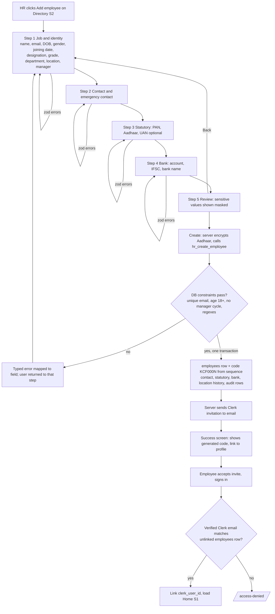
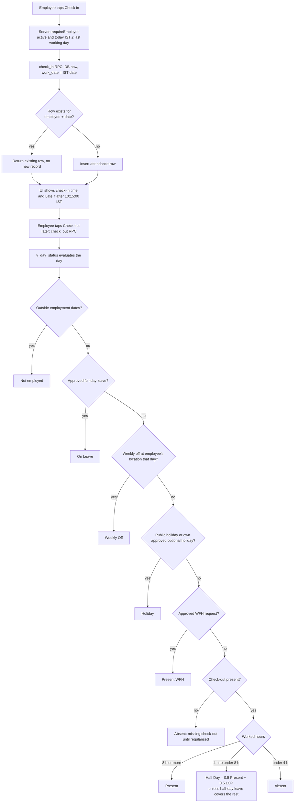
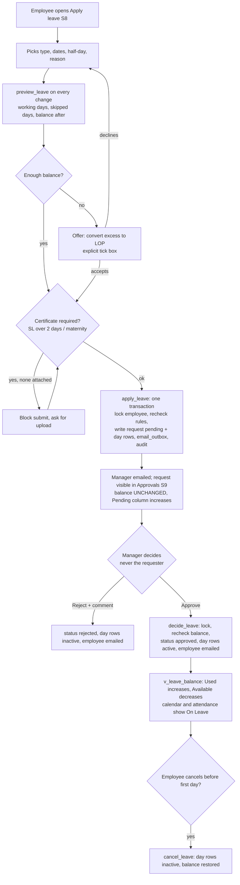
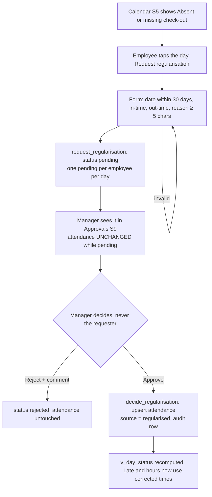
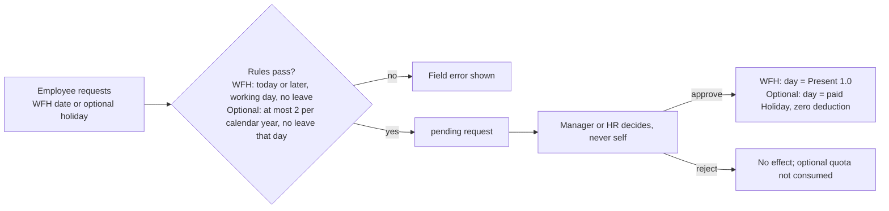

# DESIGN.md — Kinara (Konkan Coastal Foods HRMS)

Checkpoint 2. Revision 2, 2026-10-23 (navy theme; the dashboard is the front page at `/`). Companion to `ARCHITECTURE.md` (tables, RPCs, views) and `RESEARCH.md` §10 (rule IDs). **Paper only — no UI code yet.**

**Traceability convention.** Every button, input and badge below is bound to a schema column, view or RPC from `ARCHITECTURE.md` (§3 tables, §6.1 catalogue). Notation: `table.column`, `v_view.column`, `rpc_name()`. If an element has no binding it must not be built. §9 lists the gaps found while binding and how they were closed.

| § | Contents |
|---|---|
| 1 | Brand: name and logo |
| 2 | Design system: palette, type, spacing, status colours, components, form fields, states |
| 3 | Navigation and role-adaptive shell |
| 4 | User flows (flowcharts) |
| 5 | Screens S1–S14 (wireframes, bindings, states, validation) |
| 6 | Shared validation catalogue |
| 7 | Empty / loading / error states catalogue |
| 8 | Accessibility and responsiveness checklist |
| 9 | Traceability results and gaps closed |

---

## 1. Brand

**Name: Kinara** (Konkani/Hindi *kinara* = shore). Tagline: *People, simply.* Product title: "Kinara · Konkan Coastal Foods".
**Logo:** a teal rounded square with a pale sun over two white-and-aqua waves — `docs/brand/kinara-logo.svg` (already in the repo). Used at 32 px in the sidebar/app bar, 64 px on the sign-in page, and as the favicon. Clear space = ¼ of the mark's width; never recolour except to mono-white on teal.

---

## 2. Design system

### 2.1 Colour tokens (navy theme, owner decision 2026-10-23)

The first version used a light theme; the owner chose a modern **navy** look. Dark by design: deep navy page, lighter navy cards, teal accent.
Status colours (2.3) are unchanged: they stay light chips with their own dark text so they read the same on every screen.
Contrast ratios computed with the WCAG formula. Targets: >= 4.5:1 text, >= 3:1 non-text controls.

| Token | Hex | Use | Contrast |
|---|---|---|---|
| `--bg` | `#0A1A33` | Page background (with a soft teal/blue glow) | text on it **15.18** |
| `--sidebar` | `#071327` | Sidebar, top bar, phone tab bar | muted on it **9.44** |
| `--surface` | `#112547` | Cards, tables, dialogs | text on it **13.30** |
| `--surface-2` | `#17325C` | Secondary buttons, hovers | text on it **11.14** |
| `--text` | `#EAF0FA` | Body text | see above |
| `--text-muted` | `#A9BAD6` | Secondary text | **7.74** on surface, 8.84 on bg |
| `--border` | `#2A4775` | Card and divider lines (decorative) | n/a |
| `--input-border` | `#6F8DB8` | Input outlines | **4.48** vs surface (>= 3:1 required) |
| `--primary` | `#2DD4BF` | Primary buttons, links, active nav, focus ring | **8.18** on surface, 9.97 on sidebar |
| `--on-primary` | `#04213A` | Text on primary and danger buttons | **8.79** on primary |
| `--primary-dark` | `#14B8A6` | Primary hover | on-primary on it **6.57** |
| `--danger` | `#FCA5A5` | Errors, destructive | **8.02** on surface |
| `--warning` | `#FCD34D` | Warnings | **10.56** |
| `--success` | `#86EFAC` | Confirmations | **10.84** |
| `--info` | `#7DD3FC` | Info banners | **9.13** |

Never use colour as the only signal: errors carry an icon + text; statuses carry a label + icon (2.3). Keyboard focus ring is the teal primary (9.34 vs the page).

### 2.2 Typography, spacing, shape

| | |
|---|---|
| Font | **Inter** (fallback `system-ui, sans-serif`); `font-variant-numeric: tabular-nums` for balances, times, tables |
| Scale | 12 caption · 14 body-sm (tables) · 16 body (default; also minimum input size so iOS doesn't zoom) · 20 h3 · 24 h2 · 30 h1 |
| Weights | 400 body, 500 labels, 600 headings/buttons |
| Spacing | 4-px base: 4 · 8 · 12 · 16 · 24 · 32 · 48 |
| Radius / elevation | 8 px cards and inputs, 9999 px badges; cards = 1 px border, no shadow; dialogs/sheets = one soft shadow |
| Touch target | ≥ 44×44 px for every interactive element on phone |
| Breakpoints | `sm` 640 · `md` 768 · `lg` 1024. Sidebar ≥ `lg`; bottom tab bar < `md` |
| Icons | lucide-react, 16/20 px, always paired with a text label or `aria-label` |
| Time/date display | Always IST, e.g. `Fri 16 Oct 2026, 10:22 am IST`; dates `17 Oct 2026`; month `October 2026`; produced by `src/lib/time/ist.ts` on the server |

### 2.3 Status colours (identical on every screen)

One `StatusBadge` component owns these. Badge = icon + label; calendar cell = letter code + tint.

| Status | Tint (bg) | Text/border | Icon | Code | Contrast text/bg |
|---|---|---|---|---|---|
| Present | `#DCFCE7` | `#166534` | check-circle | P | 6.49 |
| Half Day | `#FEF3C7` | `#92400E` | circle-half | ½ | 6.37 |
| Absent | `#FEE2E2` | `#991B1B` | x-circle | A | 6.80 |
| On Leave | `#DBEAFE` | `#1E40AF` | plane | L | 7.15 |
| Holiday | `#EDE9FE` | `#5B21B6` | party-popper | H | 7.57 |
| Weekly Off | `#E5E7EB` | `#374151` | moon | WO | 8.33 |
| Late (flag, not a day status) | `#FFEDD5` | `#9A3412` | clock | ⏰ | 6.38 |

Modifiers (not new statuses): **WFH** = Present badge plus a house icon and the text "WFH"; **Pending** (a request awaiting approval) = dashed outline of the status colour; **Not employed** (before joining / after last working day) = empty cell with a diagonal hatch; **Future day** = white, no code; **Today, in progress** = 2-px `--primary` outline, label "Today". Half-day-leave + half-day-worked days show a split cell (L over P).
Day-status values come only from `v_day_status` (ARCHITECTURE §6); the UI never recomputes them.

### 2.4 Component catalogue (Tailwind CSS + shadcn/ui)

| Component | Built from | Notes |
|---|---|---|
| Button | shadcn `Button` | Variants `primary` (teal), `secondary` (outline), `destructive`, `ghost`, `link`; sizes `sm`/`md`/`lg`; `loading` state shows spinner and disables to stop double-submits |
| Form field | shadcn `Form` + `Label` + `Input`/`Textarea`/`Select` (react-hook-form + zod) | Label above; helper text below; **error = icon + red text below the field, `aria-invalid`, `aria-describedby`**, focus moves to the first error on submit |
| Date picker | `Popover` + `Calendar` (react-day-picker); native `<input type="date">` on phones | Stores/sends `YYYY-MM-DD` strings only |
| Select / Combobox | `Select`; `Command` for searchable manager/employee pickers | |
| Card | `Card` | `BalanceCard`, `StatCard`, `RequestCard` variants |
| Table | `Table` | Sticky header, sortable columns, 25 rows/page with `Pagination`; **< `md` collapses to stacked cards** |
| Tabs | `Tabs` | URL-synced (`?tab=`) so refresh/back works |
| Dialog / AlertDialog / Sheet | shadcn | Dialog for forms; AlertDialog for destructive confirms; Sheet for Ask HR drawer and day-detail |
| Badge | `StatusBadge` (wraps `Badge`) | Only source of status colours |
| Toast | `sonner` | Success/error confirmations; never the only place an error appears |
| Alert | `Alert` | Page-level info/warning/error banners |
| Skeleton | `Skeleton` | Per-screen skeleton layouts (§7) |
| Calendar grid | custom `CalendarGrid` + `StatusCell` | Month view, keyboard navigable (arrow keys), each cell has an `aria-label` "Friday 16 October: Present, checked in 9:58 am" |
| `MaskedField` | custom | Shows masked value; optional `RevealButton` (HR Admin, PAN/bank only); re-masks after 30 s; **no Reveal prop for Aadhaar** |
| `BalanceCard` | custom | Type name, big "available", small "Pending n · Used n" |
| `WorkingDaysCalculator` | custom | Calls `preview_leave`, shows days, skipped dates with reasons, balance after |
| `ToolCallChip` | custom | Agent tool name + inputs summary; expandable result |
| `DraftConfirmCard` | custom | Renders an `agent_drafts` row **from stored payload**, with Confirm/Discard |
| `EmptyState`, `ErrorState`, `PageHeader`, `FilterBar` | custom | Standard patterns (§7) |

### 2.5 Form-field rules (apply to every form)
Validate on blur and on submit; server errors (typed codes from RPCs) are mapped to field messages (§6); a form-level `Alert` summarises if more than one error; submit buttons show a spinner and disable while pending; sensitive values (PAN, Aadhaar, bank account) are **never echoed in an error message, toast, URL or log**; leaving a dirty multi-step form asks for confirmation.

---

## 3. Navigation and role-adaptive shell

Role is read from the database per request (ARCHITECTURE §5.1): everyone is an Employee; **Manager** = has ≥ 1 active direct report; **HR Admin** = `employees.is_hr_admin`. Menu items below are *conveniences*; the server and RLS enforce access regardless.

| Item (route) | Employee | Manager | HR Admin |
|---|---|---|---|
| Home (`/`) S1 | ✓ | ✓ + team widgets | ✓ + org widgets |
| My profile (`/profile`) S3 | ✓ | ✓ | ✓ |
| My attendance (`/attendance`) S5 | ✓ | ✓ | ✓ |
| My leave (`/leave`), Apply (`/leave/apply`) S7/S8 | ✓ | ✓ | ✓ |
| Holiday calendar (`/holidays`) S11 | ✓ | ✓ | ✓ + edit |
| Team attendance (`/team/attendance`) S6 | — | ✓ direct reports | ✓ all |
| Approvals (`/approvals`) S9 | — | ✓ | ✓ |
| Leave calendar (`/team/leave`) S10 | — | ✓ | ✓ |
| Reports (`/reports`) S13 | — | ✓ own team | ✓ all |
| Employees (`/employees`) S2, Add S4 | — | — | ✓ |
| Settings & audit (`/settings`) S12 | — | — | ✓ |
| Ask HR drawer S14 | ✓ (button in app bar) | ✓ | ✓ |

Desktop: left sidebar (logo, items, user menu), top bar (page title, date in IST, **Ask HR** button). Phone: bottom tab bar — Home · Attendance · Leave · Ask HR · More (More opens Approvals, Team, Reports, Holidays, Profile as applicable).
Unauthorised URL → same response as a non-existent record (404); deactivated or unlinked user → `/access-denied` (no menu).

---

## 4. User flows

### F1 — Add employee (HR Admin)



### F2 — Check-in to day status



### F3 — Apply leave → approval → balance update



### F4 — Missed punch → regularisation



### F5 — WFH and optional-holiday approval (shared pattern)



---

## 5. Screens

Wireframe legend: `[ Button ]` button · `[____]` input · `( )` radio · `[x]` checkbox · `▼` select · `{Badge}` status badge · `░` skeleton · `⟳` loading.

### S1 — Home dashboard (everyone; role-adaptive)

**Goal: an employee can check in and see their leave balance without clicking anything else.**

Desktop, Employee:
```
┌ Kinara ───────────────────────────────────── Fri 16 Oct 2026 · 9:58 am IST  [Ask HR] ┐
│ Good morning, Asha                                                                    │
│ ┌─ Today ─────────────────────────┐ ┌─ Leave balance (2026) ────────────────────────┐ │
│ │ {Weekly Off}/{Present}… status  │ │ ┌ CL ──────┐ ┌ SL ──────┐ ┌ EL ───────┐       │ │
│ │ Checked in 9:58 am   {Late}     │ │ │ 6.0 avail│ │ 7.0 avail│ │ 11.25 av. │       │ │
│ │ [   Check in   ]  / [ Check out]│ │ │ pending 1│ │ pending 0│ │ pending 0 │       │ │
│ │ Request WFH today →             │ │ └──────────┘ └──────────┘ └───────────┘       │ │
│ └─────────────────────────────────┘ └────────────────────────────────────────────────┘ │
│ ┌─ My pending requests ─────────────────────────────────────────────────────────────┐ │
│ │ CL  22–23 Oct · 2 days · {Pending}   [Cancel]      WFH 20 Oct · {Pending}  [Cancel] │ │
│ └────────────────────────────────────────────────────────────────────────────────────┘ │
│ Manager extra:  ┌─ Team today (9) ───────────────┐ ┌─ Needs your decision ─────────┐   │
│                 │ P 6 · WFH 1 · L 1 · Not in 1   │ │ 3 pending → Approvals          │   │
│ HR extra:       │ Active 178 · On leave 7 · Absent (no check-in) 4 · Invites pending 2│   │
│                 │ Missing check-outs yesterday 3 · [Run month-end check] (opens Ask HR)│  │
└────────────────────────────────────────────────────────────────────────────────────────┘
```
Phone (priority order; check-in is the first card, balances second):
```
┌─────────────────────┐
│ ☰ Kinara     [Ask HR]│
│ Fri 16 Oct · 9:58 IST│
│ ┌─ Today ───────────┐│
│ │ {Not checked in}  ││
│ │ ┌───────────────┐ ││
│ │ │   CHECK IN    │ ││  ← full-width, 56 px high
│ │ └───────────────┘ ││
│ │ Request WFH today ││
│ └───────────────────┘│
│ ┌ CL 6.0 ┐┌ SL 7.0 ┐ │  ← horizontal scroll cards
│ ┌ EL 11.25┐          │
│ Pending requests (2) │
│ Home Attend Leave Ask More │
└─────────────────────┘
```

| Element | Type | Binds to |
|---|---|---|
| Greeting name | text | `employees.full_name` |
| Date/time header | text | server `todayIST()` / `nowIST()` |
| Today status badge | `StatusBadge` | `v_day_status` (today, me).status; WFH icon if approved `wfh_requests` |
| Check-in time | text | `attendance.check_in` (formatted IST) |
| Late badge | `StatusBadge` | `v_day_status.is_late` |
| **Check in** | button | `check_in()` (sends no timestamp; idempotent) |
| **Check out** | button (replaces Check in once checked in) | `check_out()` |
| Worked summary after checkout | text | `v_day_status.worked_minutes` |
| Request WFH today | link → dialog | `request_wfh(work_date=today, reason)` → `wfh_requests` |
| Balance cards | `BalanceCard` ×3 (CL, SL, EL) | `v_leave_balance.available`, `.pending` for `leave_types.code` |
| Event leave note | text link | `leave_type_rules.max_days_per_request` (ML/PL) |
| Pending requests list + **Cancel** | list/button | own rows of `leave_requests`, `regularisation_requests`, `wfh_requests`, `optional_holiday_requests` where `status='pending'`; `cancel_leave()` / `cancel_request(kind,id)` |
| Manager: Team today | `StatCard` | `v_day_status` for `v_team_members` (today) |
| Manager/HR: Needs your decision | `StatCard` → `/approvals` | count of `v_pending_approvals` |
| HR: Active/On leave/Absent | `StatCard` | `employees.status`; `v_day_status` (today, all) |
| HR: Invites pending | `StatCard` | `employees.clerk_user_id IS NULL AND status='active'` |
| HR: Missing check-outs | `StatCard` | `v_day_status` rows with missing check-out |

**States.** *Loading:* skeleton of today-card + 3 balance-card shapes. *Empty:* no pending requests → "Nothing waiting. Enjoy your day." *Error:* balances fail → card-level `ErrorState` "Couldn't load balances — Retry" (check-in still works). *Special:* weekly off/holiday/on leave → info line "Today is a Weekly Off — a punch is still recorded" (AR-10); deactivated → access-denied.
**Validation.** Check-in has no input. Double-click/second device → server returns the existing row (AR-2); UI shows the original time.

### S2 — Employee directory (HR Admin)

```
┌ Employees ───────────────────────────────────────────── [ + Add employee ] ┐
│ [🔍 Search name or code____]  Department ▼  Location ▼  Status (•Active ○Inactive ○All)│
│ ┌ Code   │ Name        │ Designation │ Dept │ Location │ Manager │ Status ┐          │
│ │ KCF0007│ Asha Naik   │ Accountant  │ Fin  │ Panaji   │ R. Kamat│{Active}│ [View]   │
│ │ KCF0012│ …           │             │      │ Verna    │         │{Active}{Invite pending}│
│ └──────────────────────────────────────────────────────────────────────┘          │
│ Showing 1–25 of 180   ‹ 1 2 3 … ›                                                   │
└──────────────────────────────────────────────────────────────────────────────────────┘
```
| Element | Binds to |
|---|---|
| Search box (debounced 300 ms) | `employees.full_name` (case-insensitive contains) or `employees.employee_code` |
| Department filter | `employees.department_id` → `departments.name` |
| Location filter | `employees.location_id` → `locations.name` (current location) |
| Status radio | `employees.status` (default Active) |
| Columns | `employee_code`, `full_name`, `designation`, `departments.name`, `locations.name`, manager `full_name` via `reporting_manager_id`, `status` |
| **Invite pending** badge | `employees.clerk_user_id IS NULL` |
| **View** / row click | route `/employees/[id]` (S3) |
| **+ Add employee** | route to S4; HR only (page also server-checked) |
Sort: code, name (asc/desc). Filters live in the URL.
**States.** *Loading:* 8 skeleton rows. *Empty (filtered):* "No employees match. [Clear filters]". *Error:* "Couldn't load the directory [Retry]". Non-HR visiting the URL → 404.

### S3 — Employee profile (own profile for everyone; any profile for HR)

Tabs: **Personal · Job · Statutory · Bank · Emergency & contact** (+ **History** for HR).
```
┌ ‹ Employees   KCF0007 · Asha Naik   {Active}                [Change location][Deactivate]┐
│ [Personal] [Job] [Statutory] [Bank] [Emergency & contact] [History]                        │
│ Statutory                                                                                  │
│  PAN      ABCDE****F        [👁 Reveal]   ← HR Admin only, logged                          │
│  Aadhaar  XXXX XXXX 1234     (no reveal control exists)                                    │
│  UAN      100123456789                                                                     │
│ Bank                                                                                       │
│  Account  •••••••• 1234     [👁 Reveal]   ← HR Admin only, logged                          │
│  IFSC     HDFC0001234       Bank  HDFC Bank                          [Edit] (HR only)      │
└────────────────────────────────────────────────────────────────────────────────────────────┘
```
Edit permissions (brief p.5):

| Tab | Field → column | Employee (own) | Manager (own) | HR Admin |
|---|---|---|---|---|
| Personal | Full name `employees.full_name`, DOB `.dob`, Gender `.gender`, Email `.email` | read | read | edit (`hr_update_employee`) |
| Job | `employee_code` (never editable), `date_of_joining`, `designation`, `department_id`, `location_id`*, `reporting_manager_id`, `salary_grade`, `status`, `last_working_day`, `is_hr_admin` | read-only | read-only | edit; *location only via **Change location** → `transfer_employee(location_id, effective_from)`; status only via **Deactivate** |
| Statutory | `pan`, `aadhaar_last4`, `uan` (via `v_statutory_masked`) | masked, read | masked, read | masked; **Reveal PAN** → `reveal_statutory(id,'pan')`; edit → `hr_update_statutory` (Aadhaar: replace-only, never displayed) |
| Bank | `account_number` (masked), `ifsc`, `bank_name` (via `v_bank_masked`) | masked, read | masked, read | masked; **Reveal account** → `reveal_statutory(id,'bank_account')`; edit → `hr_update_bank` |
| Emergency & contact | `employee_contact.mobile`, `address_line1/2`, `city`, `state_code`, `pin_code`, `ec_name`, `ec_relationship`, `ec_mobile` | **edit** (`update_my_contact`) | edit own | edit |
| History (HR) | `audit_log` rows for this `record_id`: `changed_at`, `changed_by`, `field`, `old_value`, `new_value`, `action` | — | — | read |

Masked formats (E7): PAN `ABCDE****F`; Aadhaar `XXXX XXXX 1234`; bank account `•••••••• 1234` (last 4). A **Reveal** shows the value in place for 30 s (`MaskedField`), then re-masks; the click is written to `audit_log` (`action='reveal'`). Reveal controls render only for HR Admin and only for PAN and bank account; Aadhaar has no such control in the component API.
**Deactivate dialog (HR, AlertDialog).** Field: *Last working day* (`employees.last_working_day`, date ≥ `date_of_joining`; may be past or future). Text: "Asha will be unable to sign in after 31 Oct 2026. The record is kept." If the person has active direct reports, the confirm button is disabled and the dialog lists them with a *Reassign to ▼* picker (`reporting_manager_id` via `hr_update_employee`) — DV-11. Submit → `deactivate_employee()`.
**Change-location dialog.** `locations.id` + *Effective from* date → `transfer_employee()`; helper text "Past days keep their original location's weekly offs and holidays."
**States.** *Loading:* tab skeleton (label/value rows). *Error:* tab-level retry. *Unknown or forbidden id:* 404 (identical response). *Edit success:* toast "Saved". *Validation:* §6.

### S4 — Add / edit employee (HR Admin, multi-step)

```
┌ Add employee ─ Step 2 of 5: Contact ───────────────────────────────┐
│ ① Job  ② Contact  ③ Statutory  ④ Bank  ⑤ Review     (progress bar) │
│ Employee code   Auto-generated when saved           (read-only)    │
│ Mobile*         [__________]  10 digits, starts 6–9                │
│ Address line 1  [__________]   Line 2 [__________]                 │
│ City [______]   State ▼ (36 states/UTs)   PIN code [______]        │
│ Emergency contact name* [______] Relationship* [____] Mobile* [___]│
│                                          [ Back ]  [ Next ]        │
└────────────────────────────────────────────────────────────────────┘
```
Step → fields → columns:

| Step | Inputs (→ column) |
|---|---|
| ① Job & identity | Full name → `employees.full_name`; Email → `employees.email`; DOB → `dob`; Gender → `gender`; Date of joining → `date_of_joining`; Designation → `designation`; Salary grade → `salary_grade`; Department ▼ → `department_id`; Location ▼ → `location_id` (also seeds `employee_location_history`); Reporting manager (searchable) → `reporting_manager_id` (excludes self and the person's descendants; blank allowed only for the top of the hierarchy); HR Admin checkbox → `is_hr_admin` |
| ② Contact | Mobile → `employee_contact.mobile`; Address → `address_line1/2`, `city`; State ▼ → `state_code` (from `indian_states`); PIN → `pin_code`; Emergency contact → `ec_name`, `ec_relationship`, `ec_mobile` |
| ③ Statutory | PAN → `employee_statutory.pan`; Aadhaar → `aadhaar_ciphertext` + `aadhaar_last4` (encrypted by the server before the RPC; field is `type=password`-style masked as typed); UAN (optional) → `uan` |
| ④ Bank | Account number + **Confirm account number** → `employee_bank.account_number`; IFSC → `ifsc`; Bank name → `bank_name` |
| ⑤ Review | Read-only summary, sensitive values masked; **Create employee** → `hr_create_employee()` (single transaction; generates `employee_code`, writes audit rows) |

Edit mode reuses the same fields; `employee_code` is read-only; Aadhaar shows `XXXX XXXX 1234` with a **Replace** button (write-only); PAN/bank show masked with **Replace**. Multi-step state lives in the client until step ⑤ (a refresh warns about data loss). Field rules: §6. Server errors map back to the owning step.
**States.** *Loading:* spinner on Create; *Success:* page "Employee KCF0031 created — invitation sent to asha@…" with [View profile] [Add another]; *Error:* typed error → field message + jump to the step; network error → retry keeps data.

### S5 — My attendance & regularisation

```
┌ My attendance ───────────────────────── ‹ October 2026 ›   Present 14 · WFH 2 · Half 1 │
│                                                              Absent 0 · Late 2 of 3 ⏰ │
│  Mon   Tue   Wed   Thu   Fri   Sat   Sun                                              │
│ ┌────┬─────┬─────┬─────┬─────┬─────┬─────┐                                            │
│ │    │     │     │  1  │  2  │  3  │  4  │   cells: date, code letter, tint,          │
│ │    │     │     │ P   │ P⏰ │ WO  │ WO  │   Late = ⏰ , WFH = 🏠                       │
│ └────┴─────┴─────┴─────┴─────┴─────┴─────┘                                            │
│ Legend: P Present · ½ Half Day · A Absent · L On Leave · H Holiday · WO Weekly Off    │
│ My requests ▾  Regularisation / WFH: date · status · [Cancel]                         │
└────────────────────────────────────────────────────────────────────────────────────────┘
Day drawer (Sheet):  Fri 2 Oct · {Present} {Late} · In 10:22 am · Out 6:41 pm · 8 h 19 m
                     [Request regularisation]  [Request WFH]
```
| Element | Binds to |
|---|---|
| Month navigator | month param (IST) |
| Day cells | `v_day_status` (me, month): `status`, `is_late`, WFH flag |
| Summary strip | `month_summary` counts for me; Late progress = `late_count` of `policy_settings.late_marks_per_half_day` (3) — text "2 of 3: the next Late costs ½ day LOP" |
| Drawer times | `attendance.check_in`, `.check_out` (IST), `v_day_status.worked_minutes` |
| **Request regularisation** (enabled for days within `policy_settings.leave_backdate_days` = 30 whose status is Absent/Half Day/missing check-out) | form → `request_regularisation(work_date, requested_in, requested_out, reason)` → `regularisation_requests` |
| Regularisation form inputs | `work_date` (date, prefilled), `requested_in`, `requested_out` (time, IST), `reason` (textarea, ≥ 5 chars; `regularisation_requests.reason`) |
| **Request WFH** (days today or later) | form → `request_wfh(work_date, reason)` → `wfh_requests` (`reason` ≥ 5 chars) |
| My requests table + **Cancel** (pending only) | own `regularisation_requests` / `wfh_requests` (`status`, `decided_comment`); `cancel_request(kind, id)` |
Rules shown as helper text: "You can request corrections up to 30 days back", "WFH counts as Present only after your manager approves."
**States.** *Loading:* month-grid skeleton (5×7 cells) + summary skeleton. *Empty (new joiner/before joining):* cells hatched "Not employed". *Error:* "Couldn't load attendance [Retry]". *Validation:* `requested_out` after `requested_in`; date within window; one pending request per date ("You already have a pending request for this day").

### S6 — Team attendance (Manager: direct reports; HR: all)

```
┌ Team attendance ──────── [Today] [Month grid]                Location ▼ Dept ▼ (HR only) ┐
│ Today · Fri 16 Oct   Present 6 · WFH 1 · On leave 1 · Not checked in 1 · Absent 0         │
│ Name          Status               In        Out      Late                                 │
│ Asha Naik     {Present}            9:58 am   —                                              │
│ Ravi Kamat    {On Leave} CL                                                                │
│ Meena Fal     {Present} 🏠 WFH                                                              │
│ Dinesh P.     Not checked in yet                                                           │
│ Pending: 2 regularisation · 1 WFH →  (opens Approvals S9, filtered)                        │
│ Month grid:  rows = people, columns = days 1–31, cells = status codes, Late ⏰ dot          │
└─────────────────────────────────────────────────────────────────────────────────────────────┘
```
| Element | Binds to |
|---|---|
| People list | `v_team_members` (manager: `reporting_manager_id = me`; HR: all active) |
| Status chip, In/Out, Late | `v_day_status` (today); In/Out from `attendance` via RLS (manager sees direct reports only) |
| "Not checked in yet" | no attendance row and day not yet ended (before day end it is *not* Absent — F2) |
| Month grid | `v_day_status` (month) for the same people |
| Pending shortcuts | counts from `v_pending_approvals` where `kind` = regularisation / wfh |
| **Correct record** (HR Admin only; row action) | dialog: `work_date`, `check_in`, `check_out`, **reason (required)** → `hr_correct_attendance(reason)` → writes `attendance.source='hr_correction'` + `audit_log` (`action='correction'`) |
| Managers have **no edit** control | brief p.5 "Request only": managers act on employees' regularisation requests in S9; they cannot change a record directly |
**States.** *Loading:* list skeleton. *Empty:* manager with no reports → "You have no direct reports" (menu item hidden anyway). *Error:* retry. HR filters: `locations`, `departments`.

### S7 — My leave

```
┌ My leave ─ Year ▼ 2026 ──────────────────────────────────── [ Apply for leave ] ┐
│ ┌ Casual (CL) ──────┐ ┌ Sick (SL) ────────┐ ┌ Earned (EL) ──────┐ ┌ LOP ──────┐ │
│ │ Available  6.0    │ │ Available 7.0     │ │ Available 11.25   │ │ Taken 1.0 │ │
│ │ Opening 0 · Accrued 8 · Adjusted 0 · Used 2 · Pending 1                       │ │
│ └───────────────────┘ └───────────────────┘ └───────────────────┘ └───────────┘ │
│ Maternity / Paternity: event-based, not part of the balance (Paternity ≤ 5 working days) │
│ History   Status ▼   ┌ Type │ From–To │ Days │ LOP │ Status │ Decided by / comment ┐   │
│                      │ CL   │ 22–23 Oct│ 2.0 │ 0   │{Pending}│            [Cancel] │   │
└──────────────────────────────────────────────────────────────────────────────────────┘
```
| Element | Binds to |
|---|---|
| Year select | `v_leave_balance.year` |
| Balance card values | `v_leave_balance`: `opening`, `accrued`, `adjusted`, `used`, `pending`, `available` per `leave_types.code` (Pending is shown separately and never reduces the displayed Available — LR-2) |
| LOP card | sum of `leave_request_days` with `leave_type_id`=LOP, approved, in year |
| History table | `leave_requests`: `leave_type_id`, `from_date`, `to_date`, `days`, `lop_days`, `status`, `decided_by` → name, `approver_comment`, `attachment_path` (link, signed URL) |
| Status badge | pending / approved / rejected / cancelled (neutral palette: dashed, green-tint, red-tint, grey) — *not* the day-status colours |
| **Cancel** (pending, or approved with `from_date` > today IST) | `cancel_leave()` |
| **Apply for leave** | route S8 |
**States.** *Loading:* 4 card skeletons + 5 row skeletons. *Empty:* "You haven't applied for leave this year. [Apply for leave]". *Error:* retry. Cancel confirm (AlertDialog): "Cancel CL 22–23 Oct? Your balance will be restored."

### S8 — Apply leave (with working-days calculator)

Desktop:
```
┌ Apply for leave ───────────────────────────────────────────────────────────────────┐
│ Leave type* ▼ [Casual Leave (CL) · 6.0 available]                                  │
│ From* [2026-10-23]   To* [2026-10-27]   [ ] Half day  (•First half ○Second half)    │
│ Reason* [___________________________________________] 0/500                         │
│ Attachment [ Upload PDF/JPG/PNG ≤ 5 MB ]  (required for SL over 2 days / Maternity)  │
│ ┌ Working days ───────────────────────────────────────────────────────────────────┐ │
│ │  Fri 23 Oct  ✓ counts     Sat 24 Oct  – Weekly Off (not counted)                │ │
│ │  Sun 25 Oct  – Weekly Off Mon 26 Oct  ✓ counts     Tue 27 Oct  ✓ counts          │ │
│ │  Total: 3 working days     Balance 6.0 → after approval 3.0   (1 pending)       │ │
│ └─────────────────────────────────────────────────────────────────────────────────┘ │
│ [x] Convert 1 day to Loss of Pay   ← appears only when the balance is short         │
│ Your manager R. Kamat will be emailed.                         [ Cancel ] [ Submit ] │
└─────────────────────────────────────────────────────────────────────────────────────┘
```
Phone: same fields stacked in one column; the calculator card sits above a **sticky Submit** bar; native date inputs; attachment via the camera/file picker.
| Element | Binds to |
|---|---|
| Leave type select (only types applicable to the employee: `applicable_gender`, `is_active`) | `leave_requests.leave_type_id` ← `leave_types`; label shows `v_leave_balance.available` |
| From / To | `leave_requests.from_date`, `.to_date` |
| Half-day checkbox (shown only if `leave_type_rules.half_day_allowed` and From = To) | `leave_requests.is_half_day`; radio → `half_day_session` |
| Reason | `leave_requests.reason` |
| Attachment | private Vercel Blob (server-side upload) → `leave_requests.attachment_path` |
| **Calculator panel** (debounced 300 ms) | `preview_leave()` → per-date breakdown from `count_working_days` (weekly off at `location_on(employee,date)`, holiday name, own approved optional holiday), total `days`, `v_leave_balance.available`/`pending`, `lop_days` |
| **Convert excess to LOP** checkbox | submit flag → `apply_leave(convert_excess_to_lop=true)`; stores paid part on the chosen type and excess as LOP in `leave_request_days.leave_type_id` and `leave_requests.lop_days` (LR-8) |
| Manager notice | `v_my_manager` (or "HR" if none — LR-19) |
| **Submit** | `apply_leave()` (one transaction; writes `email_outbox`) |
Special types: **Maternity** — single continuous range, helper "26 weeks = 182 calendar days; ends {date}", document required, no half-day, no balance shown ("does not use CL/SL/EL"); **Paternity** — max 5 working days, no half-day. Both come from `leave_type_rules` (`max_days_per_request`, `must_be_continuous`, `doc_required_over_days`).
**States.** *Loading:* calculator shows skeleton rows while `preview_leave` runs. *Empty (before dates chosen):* calculator says "Choose dates to see working days". *Errors (inline, §6):* too far back, overlap (lists dates), certificate required, insufficient balance (offers LOP), range invalid, maternity/paternity limits. *Success:* toast + redirect to S7 with the new row highlighted.

### S9 — Approvals inbox (Manager; HR Admin) — leave, regularisation, WFH, optional holiday

This screen is where "Team Attendance & Approvals" and "Team Leaves & Approvals" decisions happen.
```
┌ Approvals ─ [All 5] [Leave 2] [Regularisation 1] [WFH 1] [Optional holiday 1] [Decided] ┐
│ ┌─ Asha Naik · KCF0007 ───────────────────────────────────── {Leave} ─────────────────┐ │
│ │ CL · 23–27 Oct · 3 working days   Balance 6.0 → 3.0   ⚠ Ravi also on leave 26–27 Oct │ │
│ │ Reason (employee text): "Family function"                          📎 certificate    │ │
│ │ Comment [________________]            [ Reject ]  [ Approve ]                        │ │
│ └──────────────────────────────────────────────────────────────────────────────────────┘ │
│ ┌─ Meena Fal ── Regularisation · Wed 14 Oct · in 9:55 am, out 6:30 pm · "Forgot to punch out" … │
└──────────────────────────────────────────────────────────────────────────────────────────┘
```
| Element | Binds to |
|---|---|
| Tabs/counts | `v_pending_approvals.kind` ∈ leave, regularisation, wfh, optional_holiday (only requests the caller may decide: manager = direct reports; HR = all; never own) |
| Requester | `employees.full_name`, `employee_code` |
| Leave row | `leave_requests.leave_type_id`, `from_date`, `to_date`, `days`, `lop_days`, `reason`, `attachment_path`; balance `v_leave_balance.available`; clash warning = other direct reports' `leave_request_days` on the same dates |
| Regularisation row | `regularisation_requests.work_date`, `requested_in`, `requested_out`, `reason` |
| WFH row | `wfh_requests.work_date`, `reason` |
| Optional-holiday row | `holidays.name`, `holiday_date`; remaining quota = `policy_settings.optional_holidays_per_year` − approved/pending count |
| Comment | `leave_requests.approver_comment` / `*.decided_comment`; **required on Reject**, optional on Approve |
| **Approve** / **Reject** | `decide_leave()`, `decide_regularisation()`, `decide_wfh()`, `decide_optional_holiday()` (→ `status`, `decided_by`, `decided_at`) |
| Decided tab | last 30 days of the caller's decisions |
User-entered text (reasons) is shown in a quoted, escaped block and labelled "Employee's words". An approval that fails (e.g. balance no longer sufficient, request already cancelled) shows the reason inline and refreshes the row.
**States.** *Loading:* 3 card skeletons. *Empty:* "You're all caught up — no pending requests." *Error:* "Couldn't load approvals [Retry]". Buttons disable and spin while pending (no double-decide).

### S10 — Leave calendar (Manager: direct reports; HR: all)

```
┌ Team leave ─ ‹ October 2026 ›   Type ▼ All   (HR: Location ▼ Dept ▼)                       ┐
│              1  2  3  4  5  6  7  8 ...                                                    │
│ Asha Naik    .  .  .  WO WO .  .  .      ▓▓ CL approved   ░░ pending (hatched)            │
│ Ravi Kamat   .  .  .  WO WO ▓▓ ▓▓ .                                                       │
│ Clash row    .  .  .  .  .  2  2  .      ← ≥ 2 people off the same day shown as "2"       │
└────────────────────────────────────────────────────────────────────────────────────────────┘
```
| Element | Binds to |
|---|---|
| Rows | `v_team_members` |
| Cells | `leave_request_days` (`leave_date`, `leave_type_id`, `day_fraction`, `is_active`) joined to `leave_requests.status` (approved solid, pending hatched) |
| Weekly off / holiday shading | `location_weekly_offs` via `location_on`, `holidays` |
| Clash count row | count of active `leave_request_days` per `leave_date` |
| Day click | list of people and types for that date |
**States.** *Loading:* grid skeleton. *Empty:* "No leave planned this month." *Error:* retry.

### S11 — Holiday calendar (everyone; HR edits)

```
┌ Holidays 2026 ──  Site: (•Panaji · 5-day week, Sat+Sun off)  (○Verna · 6-day week, Sun off) ┐
│ ⓘ You are viewing Verna's calendar (read-only). Your site is Panaji.   ← shown when toggled   │
│ October 2026                                                                                  │
│ 2 Oct  Fri  Gandhi Jayanti        {National}                                                  │
│ 20 Oct Tue  Naraka Chaturdashi    {Optional}   [Choose this day]  1 of 2 left                 │
│ 19 Dec Sat  Goa Liberation Day    {State}      (falls on Weekly Off at Panaji)                │
│ [ + Add holiday ]  (HR only)                                                                  │
└───────────────────────────────────────────────────────────────────────────────────────────────┘
```
| Element | Binds to |
|---|---|
| Site toggle (default = own `employees.location_id`) | `locations.id`; helper label from `location_weekly_offs.weekly_off_days` (`{6,7}` → "5-day week, Sat+Sun off"; `{7}` → "6-day week, Sun off") |
| Month/year navigation | date range |
| List/calendar entries | `holidays.holiday_date`, `.name`, `.type` (National / State / Optional badges) |
| Weekly-off shading | `location_weekly_offs` effective for that date |
| "Falls on Weekly Off" note | holiday date's weekday ∈ weekly offs (LR-10) |
| **Choose this day** (Optional, own site only, future date) | `request_optional_holiday(holiday_id)` → `optional_holiday_requests` |
| Optional status chip + **Cancel** | `optional_holiday_requests.status`; `cancel_request('optional_holiday', id)` |
| Quota text "n of 2 left" | `policy_settings.optional_holidays_per_year` − pending/approved requests in that calendar year |
| HR: **+ Add holiday** dialog | `locations` (multi-select incl. "All locations" helper → one row per site), `holidays.holiday_date`, `.name`, `.type` → `hr_upsert_holiday()` (UQ `(location_id, holiday_date)`) |
| HR: edit/remove | `hr_upsert_holiday()`; removing shows impact "N people have leave on this date; it will be released and balances restored" (LR-11) |
Viewing another site is read-only and clearly labelled; leave calculations always use the employee's own site.
**States.** *Loading:* list skeleton. *Empty:* "No holidays published for {site} {year}. HR can add them." *Error:* retry. *Validation:* duplicate date for a site → "A holiday already exists for this site on that date"; quota exceeded → "You've already chosen 2 optional holidays for 2026".

### S12 — Settings & HR admin panel (HR Admin)

Tabs: **Locations & weekly offs · Departments · Holidays (→ S11) · Leave types & rules · Leave adjustments · Audit log · Invitations**.
```
┌ Settings ─ [Locations] [Departments] [Holidays] [Leave types] [Adjustments] [Audit log] [Invitations] ┐
│ Locations                                                          [ + Add location ]                 │
│ Panaji Head Office · Panaji, GA · Weekly off: Sat, Sun (from 1 Jan 2000)    [Change weekly offs]      │
│ Verna Plant        · Verna, GA   · Weekly off: Sun      (from 1 Jan 2000)    [Change weekly offs]     │
└───────────────────────────────────────────────────────────────────────────────────────────────────────┘
```
| Tab | Elements → bindings |
|---|---|
| Locations | name `locations.name`, city `.city`, state `.state_code`, active `.is_active` → `hr_upsert_location()`. **Change weekly offs** dialog: Mon–Sun checkboxes → `location_weekly_offs.weekly_off_days`; *Effective from* date → `.effective_from` (not inside an exported month — `month_exports`) → `hr_set_weekly_offs()` |
| Departments | `departments.name`, `.is_active` → `hr_upsert_department()` (cannot deactivate if active employees remain) |
| Leave types & rules | read `leave_types` + current `leave_type_rules`; **Edit rule** dialog: `annual_quota`, `accrual_method`, `accrual_per_month`, `carry_forward_max`, `half_day_allowed`, `doc_required_over_days`, `max_days_per_request`, `must_be_continuous`, `min_service_days`, **Effective from year** (current or next only) → `hr_upsert_leave_type_rule()`. Banner: "Past years are not changed." |
| Leave adjustments | employee picker, leave type, year, days (± , 0.5 steps), reason (required) → `hr_adjust_leave()` → `leave_adjustments`; list of past adjustments |
| Audit log | filters: table (`audit_log.table_name`), employee, field, `action` (insert/update/reveal/config/correction), changed-by, date range (IST); columns `changed_at`, `changed_by`, `action`, `table_name`, `record_id`→employee code, `field`, `old_value`, `new_value`, `reason`. Sensitive values appear **masked** (they are stored masked). Read-only; no edit/delete controls exist |
| Invitations | list of `employees` where `clerk_user_id IS NULL AND status='active'`; **Resend invite** (server → Clerk API; no DB write) |
Employee onboarding and deactivation are entered from S2/S3/S4 (HR). **States.** *Loading:* table skeletons. *Empty:* audit log with no rows for filter → "No changes match these filters". *Error:* retry. Destructive actions use `AlertDialog`.

### S13 — Reports: month-end attendance export (Manager: own team; HR: all)

```
┌ Reports ─ Month-end attendance summary ──────────────────────────────────────────┐
│ Month ▼ [September 2026]   Scope ▼ [All employees | Panaji | Verna | Dept…] (HR)  │
│ ⚠ 2 requests still pending in this month. [View]                                  │
│ ⓘ Last exported 1 Oct 2026, 11:02 am by Priya (HR).  Figures changed since → re-export │
│ Code    Name        Present WFH CL SL EL ML PL LOP Hol WO Late  Days               │
│ KCF0007 Asha Naik   16      2   1  0  0  0  0  0.5  1   8  2    28                 │
│ Totals check: present+WFH+leave+LOP+holidays+weekly offs = days employed ✓          │
│ [ Download CSV ]                                                                  │
└───────────────────────────────────────────────────────────────────────────────────┘
```
| Element | Binds to |
|---|---|
| Month select (completed months only; current month disabled with tooltip "Available after month end (IST)") | `month_summary(month, scope)` input |
| Scope select (HR) / fixed "My team" (Manager) | `locations`, `departments`, `v_team_members` |
| Table & CSV columns | `employee_code`, `full_name`, `location` (at month end), `days_employed`, `present_days` (excl. WFH, net of late-LOP), `wfh_days`, leave days by type (CL, SL, EL, ML, PL), `lop_days` (approved LOP leave + Absent + ½ Half Day + late-LOP), `holidays`, `weekly_offs`, `late_marks` |
| Reconciliation line | invariant LR-18 computed from the same rows (must be ✓ for every row) |
| Pending warning | counts of pending `leave_requests`, `regularisation_requests`, `wfh_requests`, `optional_holiday_requests` dated in the month and scope |
| Last-export banner | `month_exports` (`exported_at`, `exported_by`, `content_hash` vs current) |
| **Download CSV** | server streams CSV (UTF-8 with BOM, ISO dates, `kinara_attendance_YYYY-MM_<scope>.csv`) → `log_month_export()` writes `month_exports`. **No PAN, Aadhaar or bank fields exist in the export**; the CSV writer still passes every cell through the mask filter (defence in depth) |
**States.** *Loading:* table skeleton (10 rows × 12 cols). *Empty:* "No employees in this scope for {month}". *Error:* "Couldn't generate the summary [Retry]" — the Download button stays disabled. Pending-requests confirm dialog: "2 requests are still pending; the export will not include them. Download anyway?"

### S14 — Ask HR (assistant drawer / modal)

Desktop: right-hand `Sheet` 420 px, opened from the app-bar **Ask HR** button on any page. Phone: full-screen sheet with a sticky input.
```
┌ Ask HR ────────────────────────────── ✕ ┐
│ I can check your balance, holidays and  │
│ working days, and draft a leave request.│
│ I never see Aadhaar, PAN or bank data.  │
│ ─────────────────────────────────────── │
│ You: kal ki chutti chahiye, kitni CL bachi hai? │
│ ┌ 🔧 get_my_leave_balance({})  ✓ ┐  ← tools the agent called (expandable) │
│ ┌ 🔧 count_working_days({from:2026-10-17,to:2026-10-17}) ✓ ┐ │
│ Assistant: Aapke paas 6.0 CL available hain. Kal (Sat) weekly off hai, isliye ek bhi din nahi katega. │
│ ┌ Draft leave request ──────────────────┐│
│ │ CL · Mon 19 Oct · 1 day · balance 6→5 ││
│ │ Expires in 14:32                      ││
│ │ [ Confirm & submit ]  [ Discard ]     ││
│ └───────────────────────────────────────┘│
│ Try: "Kitni CL bachi hai?"  "Leave Friday to Monday"  │
│ [ Type your question… 0/500 ]      [ Send ] │
└─────────────────────────────────────────────────┘
```
| Element | Binds to |
|---|---|
| Message input (≤ 500 chars) / **Send** | agent route (ARCHITECTURE §7); per-user rate limit |
| Assistant text | model output **after** the numbers-from-tools check |
| **ToolCallChip** per call | streamed from the tool wrapper; persisted as `agent_log.tool`, `.inputs`, `.result`, `.outcome` (`ok`/`denied`/`error`/`limit_exceeded`) |
| **DraftConfirmCard** | `agent_drafts.payload` (rendered by code, not model text); `expires_at` countdown |
| **Confirm & submit** | server action `confirm_draft(draft_id)` → verifies owner/status/expiry → re-runs `apply_leave()`; `agent_drafts.status='confirmed'`, `confirmed_ref` = request id |
| **Discard** | sets `agent_drafts.status='discarded'` |
| Suggested prompts | static chips; manager/HR variants ("Who's on leave today?", "Pending approvals") only if role allows (the tool also checks) |
| HR extra: `hr_month_end_check` result | flagged list + a reminder-email **DraftConfirmCard** (`agent_drafts.kind='hr_reminder_email'`); Confirm queues `email_outbox` |
The agent has **no approve/reject/cancel controls** anywhere in this UI; those exist only in S9/S7.
**States.** *Empty (first open):* greeting, capabilities, suggested prompts. *Loading:* animated "thinking" dots; a running tool shows a chip with a spinner. *Error:* "The assistant is busy right now — your screens still work. [Retry]"; rate-limited → "You've reached the question limit; try again in {m} min"; refusal → friendly text, never an apology loop; draft expired → card greys out "Expired — ask again".

---

## 6. Shared validation catalogue

Inline on blur and on submit; messages are plain language; the same rules back the DB `CHECK`s. `*` = required.

| Field → column | Rule (rule ID) | Error message |
|---|---|---|
| PAN → `employee_statutory.pan` | `^[A-Z]{5}[0-9]{4}[A-Z]$`, auto-uppercase (DV-1) | "PAN must be 5 letters, 4 digits, 1 letter — e.g. ABCDE1234F" |
| Aadhaar → `aadhaar_*` | 12 digits (DV-2); spaces stripped; never re-displayed | "Aadhaar must be 12 digits" |
| UAN → `uan` | 12 digits, optional (DV-3) | "UAN must be 12 digits (leave blank if not issued yet)" |
| IFSC → `ifsc` | `^[A-Z]{4}0[A-Z0-9]{6}$` (DV-4) | "IFSC must be 11 characters: 4 letters, a 0, then 6 letters or digits" |
| Account number → `account_number` | 9–18 digits; confirm field must match (DV-8) | "Account number must be 9–18 digits" / "Account numbers don't match" |
| Mobile, emergency mobile → `mobile`, `ec_mobile` | `^[6-9][0-9]{9}$` (DV-5) | "Enter a 10-digit mobile number starting with 6, 7, 8 or 9" |
| PIN → `pin_code` | 6 digits (DV-6) | "PIN code must be 6 digits" |
| State → `state_code` | pick from list | "Choose a state or union territory" |
| DOB / joining date → `dob`, `date_of_joining` | age ≥ 18 on joining date (DV-7) | "Employee must be at least 18 on the date of joining" |
| Email → `employees.email` | valid, unique | "Enter a valid email" / "An employee with this email already exists" |
| Reporting manager → `reporting_manager_id` | not self, not a descendant (DV-9) | "An employee cannot report to themselves or to someone who reports to them" |
| Last working day → `last_working_day` | ≥ `date_of_joining` (DV-11) | "Last working day can't be before the joining date" |
| Deactivate with reports | blocked until reassigned (DV-11) | "Reassign 3 direct reports before deactivating" |
| Leave dates → `from_date`, `to_date` | `to ≥ from`; `from ≥ today−30` (LR-13); no overlap (LR-14) | "End date must be on or after start date" / "Leave can't be applied for dates more than 30 days in the past" / "You already have leave on 23–24 Oct" |
| Half day | only if the type allows it and one date (LR-7) | "Half day is available for one date only" / "{type} can't be taken as a half day" |
| Balance | available − pending ≥ days (LR-8) | "You have 2.0 CL available but need 3.0. Convert 1 day to Loss of Pay?" |
| Certificate | SL > 2 days; Maternity always (LR-9, LR-12) | "A medical certificate is required for sick leave longer than 2 days" |
| Maternity | one continuous request ≤ 182 days; ≥ 80 days' service (LR-12) | "Maternity leave is up to 26 weeks (182 days) in one continuous period" |
| Paternity | ≤ 5 working days, one range (LR-12) | "Paternity leave is up to 5 consecutive working days" |
| Reason → `reason` | 5–500 chars after trim | "Please give a reason (at least 5 characters)" |
| Regularisation → `requested_in/out` | out > in; date within 30 days; one pending per day | "Check-out must be after check-in" / "You already have a pending request for this day" |
| WFH → `work_date` | today or later; working day; no leave | "WFH can only be requested for a working day, today or later" |
| Optional holiday | ≤ 2 per calendar year (LR-20) | "You've already chosen 2 optional holidays for 2026" |
| Manager comment | required on Reject | "Add a short comment so the employee knows why" |
| Attachment | PDF/JPG/PNG, ≤ 5 MB | "Upload a PDF, JPG or PNG under 5 MB" |
| Adjustment → `leave_adjustments` | days ≠ 0, 0.5 steps, reason required | "Enter a non-zero amount in half-day steps and a reason" |

---

## 7. Empty / loading / error states catalogue

Pattern: **Loading** = skeleton shaped like the final content (no spinners on whole pages); **Empty** = icon + one-line explanation + a primary next action; **Error** = icon + what failed + `Retry` (+ "Contact HR" link where relevant); errors never expose stack traces, IDs or data.

| Screen | Loading skeleton | Empty | Error |
|---|---|---|---|
| **Home dashboard** | today-card, 3 balance cards, 2 request rows | "Nothing waiting. Enjoy your day." (requests); manager "No one on your team has a status yet today" | Per-card: "Couldn't load balances — Retry" (check-in unaffected) |
| **Approvals inbox** | 3 request-card skeletons + tab counts as `░░` | "You're all caught up — no pending requests." | "Couldn't load approvals. [Retry]"; per-action errors inline on the card |
| **Reports** | filter bar + 10×12 table skeleton, Download disabled | "No employees in this scope for {month}." | "Couldn't generate the summary. [Retry]" — Download stays disabled |
| Directory | 8 table rows | "No employees match. [Clear filters]" | Retry banner |
| My attendance | 5×7 grid | Hatched "Not employed" cells | Retry banner |
| My leave | 4 card + 5 row skeletons | "You haven't applied for leave this year. [Apply]" | Retry banner |
| Holiday calendar | list rows | "No holidays published for {site} {year}." | Retry banner |
| Ask HR | thinking dots + tool-chip spinner | Greeting + 3 suggested prompts | "Assistant is busy…" (screens still work) |
| Any page | — | — | **Access denied** page: "You don't have access to this page" + [Home]; **404** identical for forbidden/non-existent ids |

---

## 8. Accessibility and responsiveness checklist

- Contrast: all text/background pairs in §2.1/§2.3 ≥ 4.5:1; focus ring `--primary` 2 px offset, ≥ 3:1.
- Keyboard: every control reachable; calendar grids use arrow-key navigation; dialogs trap focus and restore it; `Esc` closes sheets/dialogs.
- Screen readers: status badges have text; calendar cells have full `aria-label`s; errors announced via `aria-live="polite"`; toast duplicates are also shown inline.
- Reduced motion respected; no information conveyed by colour alone.
- **Phone-first screens:** Check-in (S1), Apply leave (S8), Ask HR (S14) are designed for 360 px width: single column, 44 px targets, sticky primary action, native date/time inputs, tables degrade to cards.
- Time zone: all displayed times come from the server in IST; the UI never converts using the browser zone.

---

## 9. Traceability results and gaps closed

Every screen was bound to the schema while writing this document. Matrix:

| Screen | Tables / views | RPCs |
|---|---|---|
| S1 Home | `employees`, `attendance`, `v_day_status`, `v_leave_balance`, `v_pending_approvals`, requests tables | `check_in`, `check_out`, `request_wfh`, `cancel_leave`, `cancel_request` |
| S2 Directory | `employees`, `departments`, `locations` | — |
| S3 Profile | `employees`, `employee_contact`, `v_statutory_masked`, `v_bank_masked`, `audit_log` | `update_my_contact`, `hr_update_*`, `reveal_statutory`, `transfer_employee`, `deactivate_employee` |
| S4 Add/edit | all employee tables, `indian_states`, `employee_location_history` | `hr_create_employee`, `hr_update_*` |
| S5 My attendance | `v_day_status`, `attendance`, `regularisation_requests`, `wfh_requests`, `policy_settings` | `request_regularisation`, `request_wfh`, `cancel_request` |
| S6 Team attendance | `v_team_members`, `v_day_status`, `attendance` | `hr_correct_attendance` |
| S7 My leave | `v_leave_balance`, `leave_requests` | `cancel_leave` |
| S8 Apply leave | `leave_types`, `leave_type_rules`, `leave_requests`, `leave_request_days`, `holidays`, `location_weekly_offs` | `preview_leave`, `apply_leave` |
| S9 Approvals | `v_pending_approvals`, 4 request tables | `decide_leave`, `decide_regularisation`, `decide_wfh`, `decide_optional_holiday` |
| S10 Leave calendar | `leave_request_days`, `v_team_members` | — |
| S11 Holidays | `holidays`, `location_weekly_offs`, `optional_holiday_requests`, `policy_settings` | `request_optional_holiday`, `hr_upsert_holiday` |
| S12 Settings/audit | `locations`, `location_weekly_offs`, `departments`, `leave_types`, `leave_type_rules`, `leave_adjustments`, `audit_log` | `hr_upsert_*`, `hr_set_weekly_offs`, `hr_adjust_leave` |
| S13 Reports | `month_summary`, `month_exports` | `month_summary`, `log_month_export` |
| S14 Ask HR | `agent_log`, `agent_drafts`, `policy_documents` | agent tools (ARCHITECTURE §7), `confirm_draft` |

**Gaps found while binding (all closed in this revision; also recorded in ARCHITECTURE §13):**
1. WFH and optional holidays needed approval workflows → added `wfh_requests`, `optional_holiday_requests`, and two more inbox tabs.
2. Holiday toggle requires reading both sites → `holidays` readable by all employees (read-only, labelled).
3. "Invite pending" and HR "Invitations" list have no stored flag → derived from `employees.clerk_user_id IS NULL`.
4. Reports needed export history → added `month_exports`.
5. Settings "edit leave rule" and "change weekly offs" would rewrite history → versioned `leave_type_rules`, `location_weekly_offs`.
6. Transfers would rewrite history → `employee_location_history`.
7. Manager "Request only" for attendance corrections is realised as: managers decide employees' regularisation requests (S9) and cannot edit records; HR corrects directly with a mandatory reason (S6).
