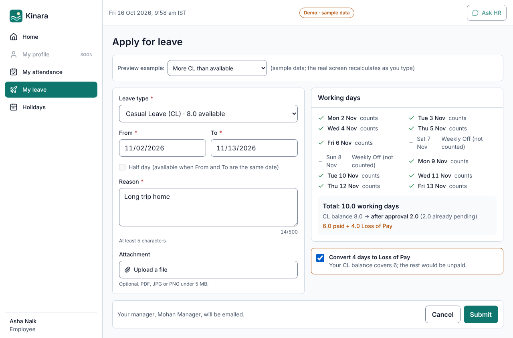
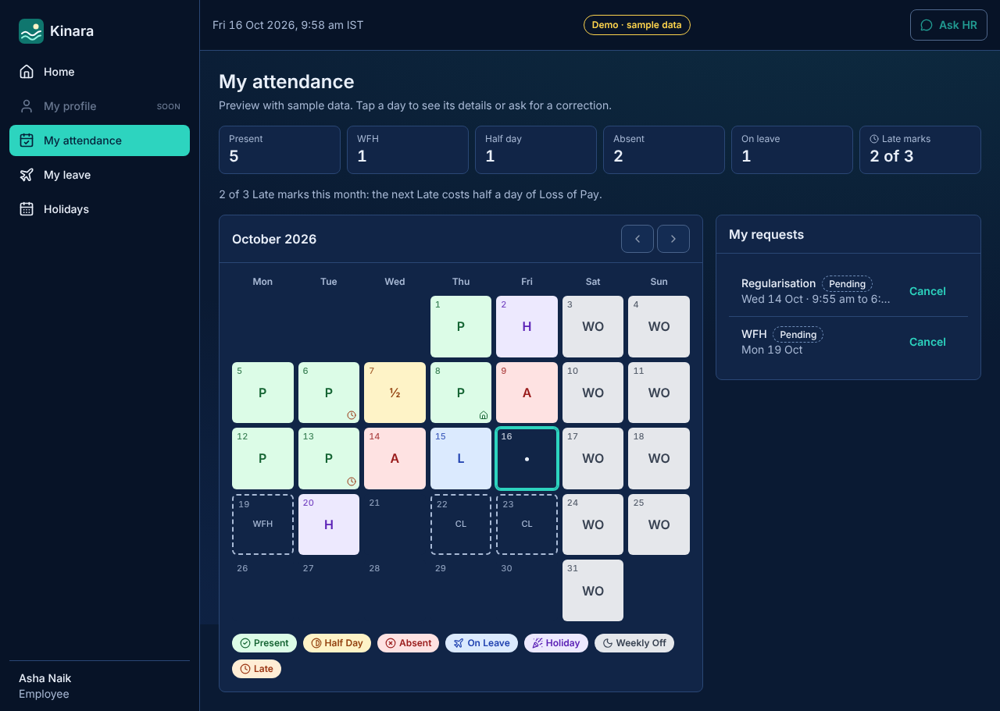

# Kinara — Konkan Coastal Foods HRMS

Employee Master, Attendance and Leave, plus an HR assistant, for Konkan Coastal Foods (Panaji head office, Verna plant).
Built for the *HRMS Build* assignment (AI Applications in HR).

**Live demo:** https://hrms-xqz4.vercel.app (sign in with your email; Clerk emails a one-time code) · **Status: work in progress (milestone 1 of 2 delivered, see below)**

## What works today

The screens below run on **sample data** (a "Demo · sample data" tag is shown on every page). The **business rules behind them are already
implemented in the database and proven by 188 automated tests**. Connecting sign-in and the live database to these screens is the next milestone.

| Screen | What it shows | Brief reference |
|---|---|---|
| Home dashboard (Employee / Manager / HR views) | Check in/out, leave balances, pending requests, team and organisation cards | Suggested screens p.14 |
| Apply for leave | Live working-days calculator (weekends/holidays skipped, no sandwich rule), balance after, convert excess to Loss of Pay, certificate rule | L3, L1 |
| My leave | Balance breakdown (opening, accrued, adjusted, used, pending), history, confirmed cancel | L2, L5 |
| My attendance | Colour-coded month calendar, Late marks, regularisation and WFH requests with validation | A2, A4, A5 |
| Approvals inbox | Leave, regularisation, WFH and optional-holiday requests; comment rules; failure shown inline | L4, A5 |
| Holiday calendar | Panaji 5-day vs Verna 6-day calendars, optional holidays (2 a year) | A7 |

Screenshots: [`docs/screenshots`](docs/screenshots). Latest test run: [`docs/test-report.txt`](docs/test-report.txt).




## What is built behind the screens (verified)

- **Data model**: 27 PostgreSQL tables with keys and constraints, row-level security on every table, masked views for PAN/Aadhaar/bank, append-only audit log (`db/migrations`).
- **Rules, single implementation in the database**: working-day count by location (weekly offs, holidays, approved optional holidays), leave balance (pro-rating to the nearest 0.5, Earned Leave carry-forward capped at 30, CL/SL lapse), day status (Present / Half Day / Absent / On Leave / Holiday / Weekly Off, Late after 10:15 IST, three Lates = half-day LOP), month-end summary with reconciliation.
- **Actions**: apply / approve / reject / cancel leave (balance re-checked at approval), check-in/out (one record per day), WFH, optional holidays, regularisation, employee add/edit/deactivate, PAN/bank reveal (logged; Aadhaar can never be revealed), leave released automatically when a holiday is added.
- **Security tests**: employees cannot open others' profiles, managers see only direct reports, nobody approves their own request, deactivated employees are locked out after the last working day, no function is open to the public, the runtime login owns nothing.

**188 database tests + 16 IST tests (run under 3 time zones) pass.** See [`docs/test-report.txt`](docs/test-report.txt).

## Milestones

| Milestone | Status |
|---|---|
| 1. Research ([`RESEARCH.md`](RESEARCH.md)) | Done; statutory figures to be verified against primary texts |
| 2. Architecture and design ([`ARCHITECTURE.md`](ARCHITECTURE.md), [`DESIGN.md`](DESIGN.md), [`CLAUDE.md`](CLAUDE.md)) | Done; faculty sign-off pending |
| 3. Fresh setup, deployed | Done (Next.js on Vercel) |
| 4. Database and rules | Done and tested locally; **not yet connected to the live app** |
| 5. Login and roles | Next (Clerk sign-in, employee row linked by email) |
| 6–10. Employee Master, Attendance, Leave, Approvals, Reports | Rules done; screens: 6 of 13 done (rest show "soon") |
| 11. HR assistant agent | Designed ([`ARCHITECTURE.md`](ARCHITECTURE.md) section 7); not built |
| 12. Test and polish | Ongoing |

Not yet done, and shown as "soon" in the app: team attendance, leave calendar, employee directory and profile, add employee, reports (CSV), settings, the HR assistant, sign-in, the seed script with test logins.

## Sign-in

Sign-in uses Clerk. It switches on automatically when `NEXT_PUBLIC_CLERK_PUBLISHABLE_KEY` and `CLERK_SECRET_KEY` are set (Vercel environment variables
or `.env.local`): every page then requires login and the dashboard opens after it. Without the keys the app runs in demo mode (sample data, "View as" switch) and opens straight to the dashboard.
With the keys, **roles come from the database**: the signed-in email must match an active employee, else `/access-denied`. Employees cannot open `/approvals`; HR Admin and Manager are decided by the `employees` table, never by the URL.
Setup: `npm run db:migrate` then `npm run db:seed` (needs `DATABASE_URL_ADMIN` and `SEED_*_EMAIL`, see `.env.example`), then set `DATABASE_URL` (the `app_runtime` login) on Vercel.
`/about` (project status) is always public.

## Run it

```bash
npm install
npm run dev          # http://localhost:3000   (prototype screens use sample data)
npm run lint && npm run typecheck
npm run test:tz      # IST helper tests under 3 time zones
npm run test:db      # database rules + security tests (needs local PostgreSQL 16 with pgTAP)
```

Environment variables are listed, blank, in [`.env.example`](.env.example). No secrets are committed.

## Stack

Next.js 16 (App Router, TypeScript, Tailwind) on Vercel · Neon PostgreSQL (row-level security) · Clerk (authentication only) · Vercel Blob · Resend · Vercel AI SDK. Reasons and rejected alternatives: [`ARCHITECTURE.md`](ARCHITECTURE.md).

## Repository map

```
RESEARCH.md  ARCHITECTURE.md  DESIGN.md  CLAUDE.md   design documents (rules have IDs: LR-*, AR-*, DV-*)
db/migrations   the database: tables, rules, actions, security
db/tests        pgTAP tests citing the rule IDs
src/lib/time    IST helpers (the only code allowed to touch clocks)
src/app         the screens (prototype, on sample data); /about = project status
docs/           screenshots, test report, logo
```
